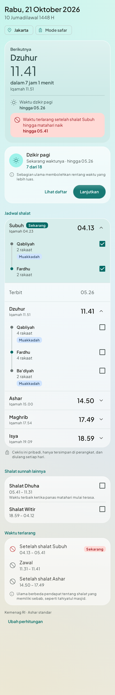
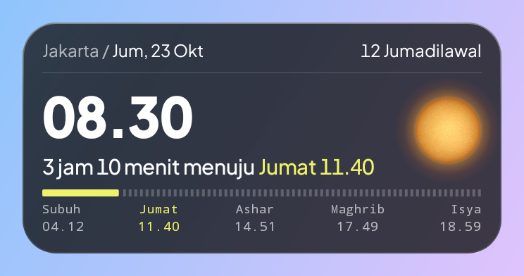
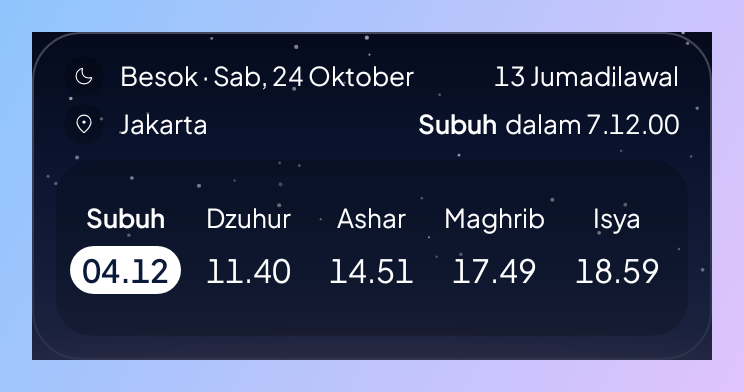
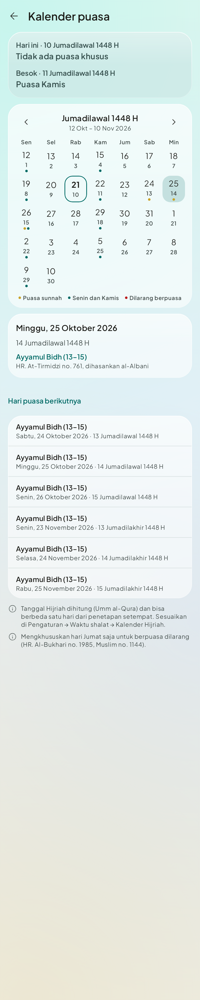
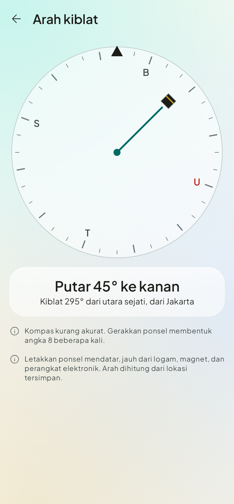

# Adwam

Adwam (أدوم, formerly Muslim Daily) is a native Android daily Muslim guide upon the manhaj salaf: prayer times, sunnah rawatib,
morning and evening adhkar, and authentic duas from waking to sleeping, with Arabic text,
translation, audio and a memorisation mode. Offline-first. No account, no ads, no analytics.

> **Content:** all of Hisnul Muslim (276 duas in 55 events; Indonesian translation and takhrij
> from the owner's edition, Arabic, English translation and the recitation by Hamad ad-Duraihim from
> hisnmuslim.com / IslamHouse.com), plus 31 supplications from the Qur'an (Tanzil text,
> Kemenag translation via QuranEnc.com, recitation by Maher al-Muaiqly from the King Fahd Complex). Every dua shows its source and takhrij. Narrations
> the edition's appendix reports al-Albani graded weak are left out. See
> [docs/content-guide.md](docs/content-guide.md).

| Today | Widgets | Fasting calendar | Qibla |
|---|---|---|---|
|  |   |  |  |

Every screen is captured in light, dark and 200% font in [docs/screenshots](docs/screenshots)
(generated by the screenshot tests; the Arabic there is a neutral typographic sample).

## Features

* **Today**: next prayer with countdown and iqamah, current windows (adhkar, prohibited,
  Duha, Witr), a qabliyah → fard → ba'diyah timeline per prayer with a private checklist that
  resets daily, Friday Jumu'ah rules, travel mode (suggested, never automatic), Hijri date.
* **First launch**: a short setup for location and reminders, each explained before Android's
  permission dialog; everything can be skipped.
* **Prayer times**: Kemenag RI by default, with its elevation correction for sunrise and
  Maghrib; within ±1 minute of the official bimasislam.kemenag.go.id schedule for 16 cities in
  WIB, WITA and WIT (tested). MWL, Umm al-Qura, custom angles, Hanafi Asr, per-prayer offsets.
  No Imsak. Around the 29th of Sya'ban, Ramadan and Zulkaidah the app asks for the sidang isbat
  result and adjusts the Hijri date.
* **Duas**: categories → events → duas, FTS search across Arabic (tashkeel-insensitive),
  Indonesian and English, source and grading sheet, virtue, audio with phrase highlighting.
* **Routines** ("Doa saya"): the reader's own ordered lists, read through with Mulai. A
  bookmark on any dua adds it; each occasion always shows its full set, in the forms chosen.
* **Run mode**: one card at a time, tap anywhere to count, haptics, optional auto-advance,
  resumes after interruption.
* **Memorize**: Listen ×2, Build (cumulative chunks with repeat-aloud pauses), Recall
  (word fade with equal-width blanks, audio gaps for TalkBack), Check, Leitner review
  (1/3/7/14/30 days), listen-only hands-free mode. No streaks.
* **Reminders**: adhan per prayer (sound or silent), morning/evening adhkar, before sleep,
  Friday, review queue. All off by default.
* **Widgets and tiles**: one prayer-times widget that resizes from 1×1 to 5×3 and adds detail
  as it grows (the time now, the time until the next prayer in words, a bar of how far the
  day has gone, the sun or tonight's moon, the date and Hijri date, the place, the day's
  times, what matters now, a sunnah fast tomorrow) on translucent black glass, which
  can sit on the lock screen where the phone allows it; an optional lock-screen next-prayer
  notification (a Live Update on Android 16); and a Quick Settings tile.
* **Nearby mosques**: an optional reminder before each prayer opens a list of mosques and
  mushalla around you from a bundled OpenStreetMap extract (75k places in Indonesia), looked
  up on the device; directions open in your maps app.
* **Qibla**: compass with turn guidance, true-north correction and a calibration hint.
* **Fasting**: Hijri calendar of sunnah fasts (Monday/Thursday, the white days, Arafah,
  Tasu'a/Asyura, Syawal) and forbidden days, each with its evidence, plus an evening-before
  reminder; a Ramadan card on Today with suhur end, iftar and the iftar duas.
* **Share and backup**: share any dua as an image that carries its source; one-file backup
  and restore of settings, sets, memorisation and checklist.
* **Colour themes**: eight palettes, all keeping the glass look and AA contrast.
* **Languages**: Indonesian UI by default, also on phones set to English; English can be
  chosen in setup or Settings → Tampilan (kept as the per-app language on Android 13+). Hisn al-Muslim
  entries keep their Indonesian translation in English until a licensed English text is added.
* **Tablets and foldables**: navigation rail from 600dp; Today in two columns and the dua
  library as list-detail from 840dp.
* **Accessibility**: WCAG 2.2 AA colours, ≥ 48dp targets, TalkBack labels and live regions,
  Arabic locale for TTS, 200% font without clipping, reduced motion. See
  [docs/accessibility.md](docs/accessibility.md).

## Build

Requirements: JDK 21, Android SDK with platform 37 and build-tools 37.0.0, Python 3.10+.

```bash
./gradlew :app:assembleDebug          # debug (sideload) APK with the in-app updater
./gradlew :app:testDebugUnitTest      # unit, Robolectric UI and screenshot tests
./gradlew :app:recordRoborazziDebug   # regenerate docs/screenshots
./gradlew :app:lintDebug
./gradlew :app:assembleRelease        # minified store build, fully offline
python3 -m unittest discover -s tools # content validator tests
```

Content: edit `content/source/*.csv`, then `python3 tools/build_content.py`. Release
signing: see [docs/release.md](docs/release.md).

Stack: Kotlin 2.3, Jetpack Compose (BOM 2026.09), Material 3, Hilt, Navigation Compose, Room
(FTS4), DataStore, Media3, WorkManager + AlarmManager, adhan-kotlin. Min SDK 26, target 37.

## Docs

| Document | For |
|---|---|
| [content-guide.md](docs/content-guide.md) | Where the content comes from and how to edit the spreadsheets |
| [design-tokens.md](docs/design-tokens.md) | Colour roles and measured contrast |
| [accessibility.md](docs/accessibility.md) | WCAG 2.2 AA audit and how each rule is met |
| [architecture.md](docs/architecture.md) | Code structure, data flow, content packs |
| [fonts.md](docs/fonts.md) | Typefaces and licences (why not KFGQPC) |
| [release.md](docs/release.md) | Signing, release gate, store listing notes |
| [ihrish-integration.md](docs/ihrish-integration.md) | Assessment of adding kajian schedules |
| [beta.md](docs/beta.md) | Running the beta, reading diagnostics, tester instructions |
| [device-qa.md](docs/device-qa.md) | Manual test pass on real phones, a watch and a tablet |
| [talkback-checklist.md](docs/talkback-checklist.md) | Task-based TalkBack test |
| [privacy-policy.md](docs/privacy-policy.md) | Privacy policy (Indonesian and English) |
| [play-store.md](docs/play-store.md) | What a Play Store release would need |
| [islamhouse-licence-request.md](docs/islamhouse-licence-request.md) | Draft licence confirmation for the Hisn audio and English text |

## Licences

Fonts under the SIL Open Font License; Material Symbols (Apache 2.0); city data © GeoNames
(CC BY 4.0); adhan-kotlin (MIT). Listed in-app under Settings → About.
