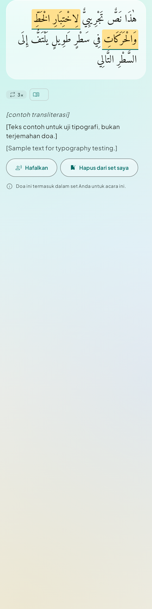
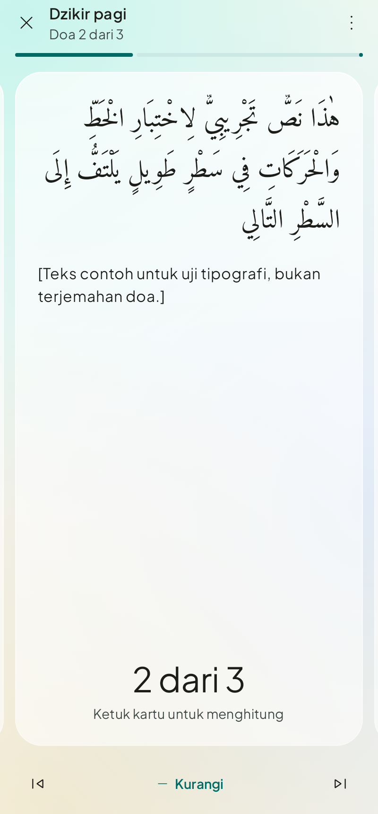
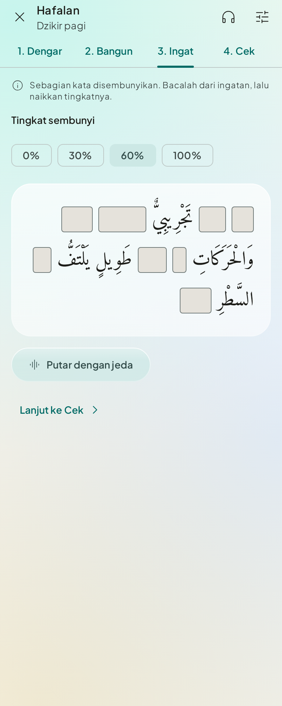

# Muslim Daily

A native Android daily Muslim guide upon the manhaj salaf: prayer times, sunnah rawatib,
morning and evening adhkar, and authentic duas from waking to sleeping, with Arabic text,
translation, audio and a memorisation mode. Fully offline. No account, no ads, no analytics.

> **Content:** duas and dzikir come from Hisnul Muslim (Indonesian translation and takhrij
> from the owner's edition, Arabic from hisnmuslim.com), imported by
> `tools/hisnul_muslim/import_hisn.py`. Every dua shows its source and takhrij. Narrations
> the edition's appendix reports al-Albani graded weak are left out. See
> [docs/content-guide.md](docs/content-guide.md).

| Today | Dua detail | Run mode | Memorize |
|---|---|---|---|
|  |  |  |  |

Every screen is captured in light, dark and 200% font in [docs/screenshots](docs/screenshots)
(generated by the screenshot tests; the Arabic there is a neutral typographic sample).

## Features

* **Today**: next prayer with countdown and iqamah, current windows (adhkar, prohibited,
  Duha, Witr), a qabliyah → fard → ba'diyah timeline per prayer with a private checklist that
  resets daily, Friday Jumu'ah rules, travel mode (suggested, never automatic), Hijri date.
* **Prayer times**: Kemenag RI by default (within ±1 minute of the official schedule, tested),
  MWL, Umm al-Qura, custom angles, Hanafi Asr, per-prayer offsets. No Imsak.
* **Duas**: categories → events → duas, FTS search across Arabic (tashkeel-insensitive),
  Indonesian and English, source and grading sheet, virtue, audio with phrase highlighting.
* **My set**: full canonical set by default; opt-in customisation (hide, reorder, choose or
  rotate variant forms), export/import as JSON.
* **Run mode**: one card at a time, tap anywhere to count, haptics, optional auto-advance,
  resumes after interruption.
* **Memorize**: Listen ×2, Build (cumulative chunks with repeat-aloud pauses), Recall
  (word fade with equal-width blanks, audio gaps for TalkBack), Check, Leitner review
  (1/3/7/14/30 days), listen-only hands-free mode. No streaks.
* **Reminders**: adhan per prayer (sound or silent), morning/evening adhkar, before sleep,
  Friday, review queue. All off by default.
* **Accessibility**: WCAG 2.2 AA colours, ≥ 48dp targets, TalkBack labels and live regions,
  Arabic locale for TTS, 200% font without clipping, reduced motion. See
  [docs/accessibility.md](docs/accessibility.md).

## Build

Requirements: JDK 21, Android SDK with platform 37 and build-tools 37.0.0, Python 3.10+.

```bash
./gradlew :app:assembleDebug          # debug (sideload) APK with the in-app updater
./gradlew :app:testDebugUnitTest      # unit, Robolectric UI and screenshot tests
./gradlew :app:recordRoborazziDebug   # regenerate docs/screenshots
./gradlew :app:lintDebug
./gradlew :app:assembleRelease        # minified store build, fully offline
python3 -m unittest discover -s tools # content validator tests
```

Content: edit `content/source/*.csv`, then `python3 tools/build_content.py`. Release
signing: see [docs/release.md](docs/release.md).

Stack: Kotlin 2.3, Jetpack Compose (BOM 2026.09), Material 3, Hilt, Navigation Compose, Room
(FTS4), DataStore, Media3, WorkManager + AlarmManager, adhan-kotlin. Min SDK 26, target 37.

## Docs

| Document | For |
|---|---|
| [content-guide.md](docs/content-guide.md) | Where the content comes from and how to edit the spreadsheets |
| [design-tokens.md](docs/design-tokens.md) | Colour roles and measured contrast |
| [accessibility.md](docs/accessibility.md) | WCAG 2.2 AA audit and how each rule is met |
| [architecture.md](docs/architecture.md) | Code structure, data flow, content packs |
| [fonts.md](docs/fonts.md) | Typefaces and licences (why not KFGQPC) |
| [release.md](docs/release.md) | Signing, release gate, store listing notes |
| [ihrish-integration.md](docs/ihrish-integration.md) | Assessment of adding kajian schedules |

## Licences

Fonts under the SIL Open Font License; Material Symbols (Apache 2.0); city data © GeoNames
(CC BY 4.0); adhan-kotlin (MIT). Listed in-app under Settings → About.
